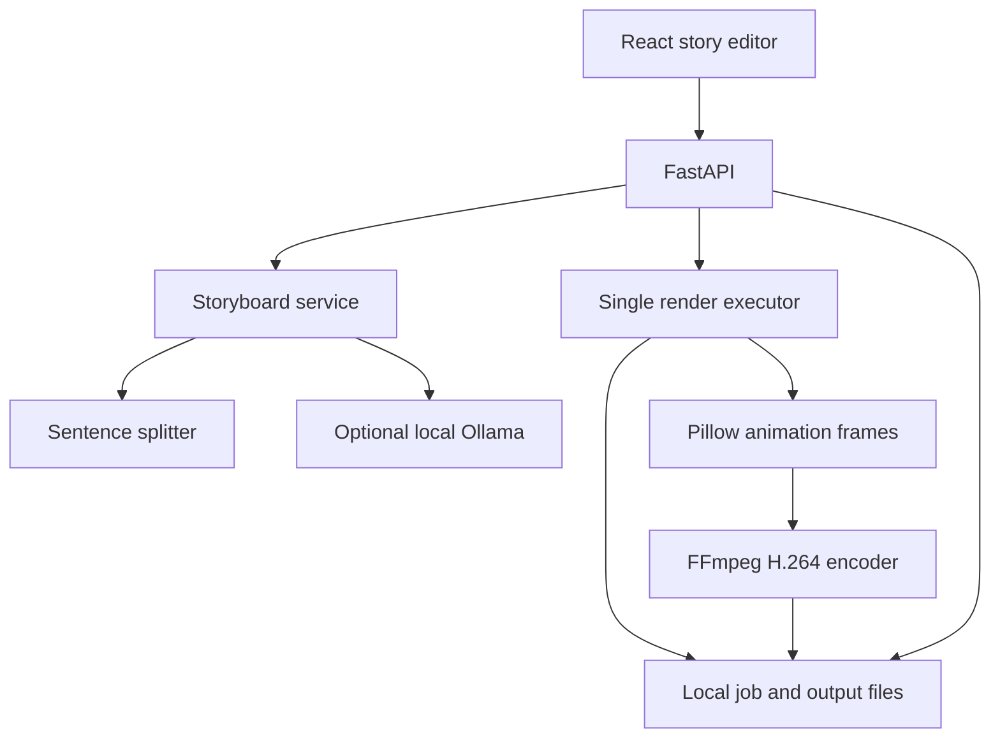

# LSEO Cartoon Studio — MVP 0.1

A local React + Python app that turns a short story into an editable storyboard and a simple animated MP4. No paid service is needed for demo mode.

## What works
- Story input → up to eight editable scenes.
- Optional Ollama LLM story generation, with validated JSON output.
- Fixed Pig and Rabbit characters with walk, jump, dance and wave animations.
- Garden, forest and night backgrounds; burned-in captions.
- Background rendering with progress, disk-persisted job status, browser playback and MP4 download.
- 640×360, 12 fps, H.264; 3–12 seconds per scene, at most 96 seconds.

**This is a pipeline MVP, not full generative text-to-video.** Demo mode splits sentences; it does not invent a story. Ollama generates a storyboard, but the renderer uses procedural 2D artwork. Videos are silent. Voice synthesis, custom character generation, AI video, music, lip sync and 1080p are not implemented. Caption rendering is designed for Latin-script text; complex scripts need shaping and suitable fonts.

## Run on your Mac
Install Python 3.11+, Node 20.19+ or 22.12+, and FFmpeg. If you use Homebrew:

```bash
brew install python ffmpeg node
```

Unzip the project. Terminal 1, from `cartoon-studio`:

```bash
python3 -m venv .venv
source .venv/bin/activate
python -m pip install -r requirements.txt
python -m uvicorn backend.main:app --host 127.0.0.1 --port 8000
```

Terminal 2:

```bash
cd cartoon-studio/frontend
npm install
npm run dev
```

Open http://localhost:5173. Paste a complete short story, choose Local demo, create storyboard, edit the scenes, then Render cartoon. Playback and download appear when rendering completes. API docs: http://127.0.0.1:8000/docs.

For repeatable installs, use `npm ci` when a package-lock.json is included. Python dependency ranges are compatibility bounds, not a fully frozen lock.

## Enable local AI story generation
Install Ollama from https://ollama.com. Run:

```bash
ollama pull llama3.2
ollama serve
```

The desktop app may already be serving Ollama; don't start a second server. Choose AI storyboard in the app. The default model is `llama3.2`; set `OLLAMA_MODEL` in the backend terminal to use another installed model. `.env.example` documents the environment variables; this app does not automatically load a `.env` file. The backend uses `/api/chat` with non-streaming JSON output, then validates the result. Invalid or unavailable provider results are reported as errors. Ollama model generation has not been exercised in the supplied automated tests.

## Architecture



`app` owns story schemas, provider selection, artwork and encoding. `app` owns API routes and job lifecycle. `frontend/src/main.jsx` owns editing, polling and playback. `data/<job-id>` stores job JSON, story JSON, scene thumbnails, encoder logs and the video. One render runs at a time; the small queue is bounded. Restarted pending jobs become failed and must be resubmitted. Use a single Uvicorn process without `--workers`; this executor is not a distributed queue.

### API
| Method | Endpoint | Purpose |
|---|---|---|
| GET | /health | Health check |
| POST | /api/storyboard | Prompt + `demo` or `ollama` → storyboard |
| POST | /api/jobs | Validated storyboard → render job (202) |
| GET | /api/jobs/{id} | Status, progress and error |
| GET | /api/jobs/{id}/video | Completed video download |

## Next stages for Option 3
1. Add a narration provider and per-scene audio. Derive scene duration from spoken audio; mux it with FFmpeg. Keep voice settings and subtitle timing in the storyboard.
2. Add a character bible: fixed descriptions, reference images, palette and voice identifiers. Pass references to an image provider. Add generated background and character assets behind the existing renderer interface.
3. Add a video provider adapter with `submit(scene, references)`, `poll(task_id)` and `download(task_id)`. Store provider task IDs, retries and costs. Model support for reference images and clip duration must be verified when choosing a provider. Reference images improve consistency but cannot guarantee it.
4. Replace local JSON with PostgreSQL; move rendering to a separate durable worker queue; store assets in object storage. Add authentication, per-user ownership, job cancellation, quotas, retention, retries and cost approval before multi-user deployment.
5. Add a final assembly step for clips, narration, captions and licensed music, with aspect ratio options for YouTube and Shorts.

The first implementation intentionally stays local: no authentication, billing or internet deployment configuration. Bind it to 127.0.0.1. Don't expose this local API as a hosted multi-user service without the ownership and worker changes above.

## Validation
```bash
python -m unittest discover -s tests -v
cd frontend
npm run build
```
The pipeline tests check story parsing, input rejection and an actual FFmpeg export with codec, dimensions and duration checks. `sample.mp4` is an actual output of the rendering pipeline. See `VALIDATION.md` for checks completed in the delivery environment.

References: FastAPI https://fastapi.tiangolo.com/tutorial/background-tasks/ ; Ollama API https://github.com/ollama/ollama/blob/main/docs/api.md . Rendering should move to a separate worker for heavy production workloads.
