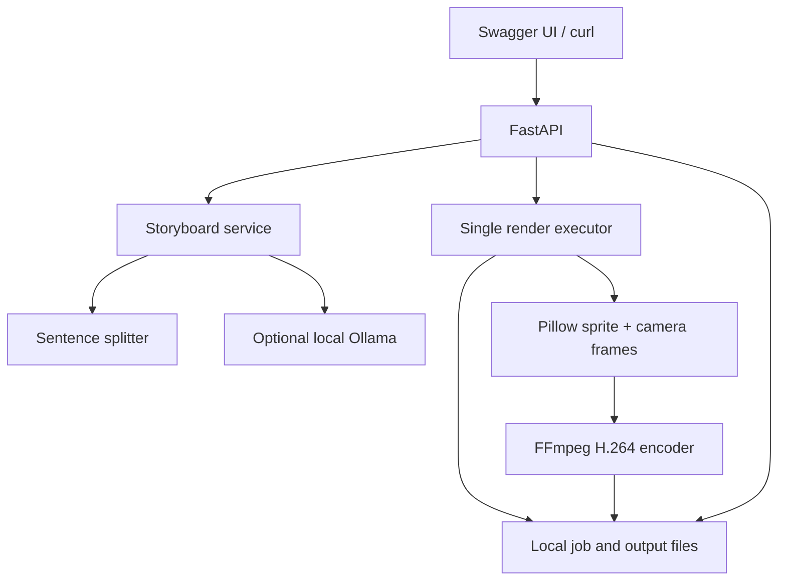

# LSEO Cartoon Studio — MVP 0.1

A local Python (FastAPI) app that turns a short story into an editable storyboard and a simple animated MP4. No paid service is needed for demo mode.

> **Note:** this package contains the backend API and a command-line renderer only. There is no browser frontend included; use the interactive API docs at http://127.0.0.1:8000/docs to drive the app (see below).

## What works
- Story input → up to eight editable scenes.
- Optional Ollama LLM story generation, with validated JSON output.
- A cat sprite character (`assets/characters/cat/`) with 26 actions (walk, run, jump, dance, wave, sleep, …) and matching camera moves.
- Garden, forest and night backgrounds (`assets/backgrounds/`).
- Background rendering with progress, disk-persisted job status and MP4 download.
- 640×360, 12 fps, H.264; 3–12 seconds per scene, at most 96 seconds.

**This is a pipeline MVP, not full generative text-to-video.** Demo mode splits sentences; it does not invent a story. Ollama generates a storyboard, but the renderer uses procedural 2D artwork. Videos are silent. Voice synthesis, custom character generation, AI video, music, lip sync and 1080p are not implemented. Scene narration is stored in the storyboard but is not drawn onto the video; frames only show a small `Action: …` label.

## Run on your Mac
Install Python 3.11+ and FFmpeg (the renderer calls `ffmpeg` from your `PATH`). If you use Homebrew:

```bash
brew install python ffmpeg
```

Unzip the project, then from the `cartoon-studio` folder (the one containing `app/` and `requirements.txt`):

```bash
python3 -m venv .venv
source .venv/bin/activate
python -m pip install -r requirements.txt
python -m uvicorn app.api.main:app --host 127.0.0.1 --port 8000
```

Always start the server from the `cartoon-studio` folder so the `app` package can be imported.

Open http://127.0.0.1:8000/docs (interactive Swagger UI) and:

1. **POST /api/storyboard** → *Try it out* → send `{"prompt": "The cat is walking in the garden. It is jumping in the forest. At night it is sleeping.", "provider": "demo"}`.
2. Copy the returned storyboard JSON, edit scenes if you like, and send it to **POST /api/jobs**. Note the returned `id`.
3. Call **GET /api/jobs/{id}** until `status` is `completed`.
4. Call **GET /api/jobs/{id}/video** to download the MP4 (or open `http://127.0.0.1:8000/api/jobs/<id>/video` in your browser to play it).

The same flow with `curl`:

```bash
curl -s -X POST http://127.0.0.1:8000/api/storyboard \
  -H 'Content-Type: application/json' \
  -d '{"prompt":"The cat is walking in the garden. It is jumping in the forest.","provider":"demo"}' > story.json
curl -s -X POST http://127.0.0.1:8000/api/jobs \
  -H 'Content-Type: application/json' -d @story.json
# -> {"id":"<job-id>","status":"queued",...}
curl -s http://127.0.0.1:8000/api/jobs/<job-id>
curl -o cartoon.mp4 http://127.0.0.1:8000/api/jobs/<job-id>/video
```

### Render a sample video without the server
With the virtual environment active, from the `cartoon-studio` folder:

```bash
python -m app.main
```

This renders the built-in sample story (`app/samples.py`) to `output/video.mp4`. Run it as a module (`-m`); `python app/main.py` fails with `No module named 'app'`.

Python dependency ranges are compatibility bounds, not a fully frozen lock.

## Enable local AI story generation
Install Ollama from https://ollama.com. Run:

```bash
ollama pull llama3.2
ollama serve
```

The desktop app may already be serving Ollama; don't start a second server. Send `"provider": "ollama"` to `POST /api/storyboard`. The default model is `llama3.2`; set `OLLAMA_MODEL` in the backend terminal to use another installed model. Set `OLLAMA_URL` if Ollama is not at `http://127.0.0.1:11434`. This app does not load a `.env` file; export variables in the backend terminal before starting Uvicorn. The backend uses `/api/chat` with non-streaming JSON output, then validates the result. Invalid or unavailable provider results are reported as errors. Ollama model generation has not been exercised in the supplied automated tests.

## Architecture



`app/models.py` defines the story schemas, `app/storyboard.py` handles provider selection (demo or Ollama), `app/assets.py`, `app/animator.py`, `app/camera.py` and `app/scene_renderer.py` draw frames, and `app/video.py` encodes them with FFmpeg; `app/container.py` wires these together. `app/api/main.py` owns API routes and the job lifecycle. `app/data/<job-id>` stores job JSON, story JSON, scene thumbnails, the encoder log and the video. One render runs at a time; the small queue is bounded. Restarted pending jobs become failed and must be resubmitted. Use a single Uvicorn process without `--workers`; this executor is not a distributed queue.

### API
| Method | Endpoint | Purpose |
|---|---|---|
| GET | /health | Health check |
| POST | /api/storyboard | Prompt + `demo` or `ollama` → storyboard |
| POST | /api/jobs | Validated storyboard → render job (202) |
| GET | /api/jobs/{id} | Status, progress and error |
| GET | /api/jobs/{id}/video | Completed video download |

## Next stages for Option 3
1. Add a narration provider and per-scene audio. Derive scene duration from spoken audio; mux it with FFmpeg. Keep voice settings and subtitle timing in the storyboard.
2. Add a character bible: fixed descriptions, reference images, palette and voice identifiers. Pass references to an image provider. Add generated background and character assets behind the existing renderer interface.
3. Add a video provider adapter with `submit(scene, references)`, `poll(task_id)` and `download(task_id)`. Store provider task IDs, retries and costs. Model support for reference images and clip duration must be verified when choosing a provider. Reference images improve consistency but cannot guarantee it.
4. Replace local JSON with PostgreSQL; move rendering to a separate durable worker queue; store assets in object storage. Add authentication, per-user ownership, job cancellation, quotas, retention, retries and cost approval before multi-user deployment.
5. Add a final assembly step for clips, narration, captions and licensed music, with aspect ratio options for YouTube and Shorts.

The first implementation intentionally stays local: no authentication, billing or internet deployment configuration. Bind it to 127.0.0.1. Don't expose this local API as a hosted multi-user service without the ownership and worker changes above.

## Validation
From the `cartoon-studio` folder, with the virtual environment active:

```bash
python -m unittest discover -s tests -v
```
The pipeline tests check story parsing, input rejection and an actual FFmpeg export with codec, dimensions and duration checks (FFmpeg and `ffprobe` must be on your `PATH`). See `VALIDATION.md` for checks completed in the delivery environment.

References: FastAPI https://fastapi.tiangolo.com/tutorial/background-tasks/ ; Ollama API https://github.com/ollama/ollama/blob/main/docs/api.md . Rendering should move to a separate worker for heavy production workloads.
