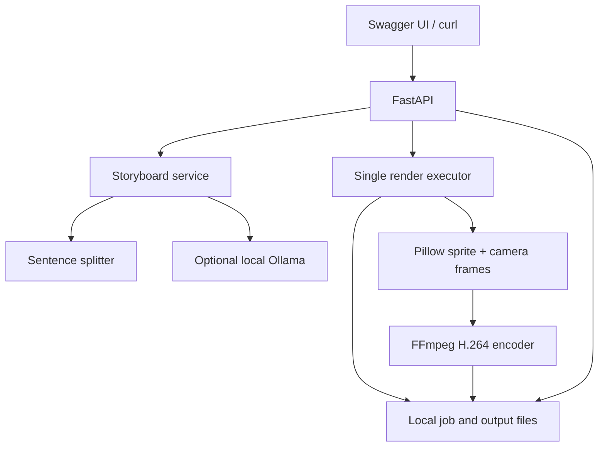

# LSEO Cartoon Studio — MVP 0.1

A local Python (FastAPI) app that turns a short story into an editable storyboard and a simple animated MP4. No paid service is needed for demo mode.

> **Note:** this package contains the backend API and a command-line renderer only. There is no browser frontend included; use the interactive API docs at http://127.0.0.1:8000/docs to drive the app (see below).

## What works
- Story input → up to ten editable scenes (set by `MAX_SCENES` in `app/config.py`).
- Optional Ollama LLM story generation, with validated JSON output.
- Six characters, each with its own expressions linked to images: the original cat (26 actions), plus a kid (40), an adult (40), a dog (33), a car (30) and a bicycle with rider (28). See [Characters](#characters).
- Stories pick the character and expression for each scene automatically; every expression has a matching motion and camera move. See [Character animation](#character-animation).
- Garden, forest and night backgrounds (`assets/backgrounds/`).
- Background rendering with progress, disk-persisted job status and MP4 download.
- 640×360, 12 fps, H.264; 3–12 seconds per scene, at most 120 seconds.

**This is a pipeline MVP, not full generative text-to-video.** Demo mode splits sentences; it does not invent a story. Ollama generates a storyboard, but the renderer uses procedural 2D artwork. Videos are silent. Voice synthesis, AI-generated characters, AI video, music, lip sync and 1080p are not implemented. Only one character appears per scene. Scene narration is stored in the storyboard but is not drawn onto the video; frames only show a small `Character: expression` label.

## Run on your Mac
Install Python 3.11+ and FFmpeg (the renderer calls `ffmpeg` from your `PATH`). If you use Homebrew:

```bash
brew install python ffmpeg
```

Unzip the project, then from the `cartoon-studio` folder (the one containing `app/` and `requirements.txt`):

```bash
python3 -m venv .venv
source .venv/bin/activate
python -m pip install -r requirements.txt
python -m uvicorn app.api.main:app --host 127.0.0.1 --port 8000
```

Always start the server from the `cartoon-studio` folder so the `app` package can be imported.

Open http://127.0.0.1:8000/docs (interactive Swagger UI) and:

1. **POST /api/storyboard** → *Try it out* → send a story, e.g. `{"prompt": "Lily wakes up and yawns in the garden. Lily waves at her dad. Dad is drinking coffee. The puppy runs into the forest. The dog barks at a bird in the forest. Lily rides her bike along the path. A red car honks hello. The car drives into the forest. At night Milo the cat dances. Dad dozes in his chair at night.", "provider": "demo"}` (ten sentences → ten scenes, six characters).
2. Copy the returned storyboard JSON, edit scenes if you like, and send it to **POST /api/jobs**. Note the returned `id`.
3. Call **GET /api/jobs/{id}** until `status` is `completed`.
4. Call **GET /api/jobs/{id}/video** to download the MP4 (or open `http://127.0.0.1:8000/api/jobs/<id>/video` in your browser to play it).

**How many scenes you get:** in demo mode each sentence (ending in `.`, `!` or `?` followed by a space, or on its own line) becomes one scene, up to 10; extra sentences are dropped, and a sentence longer than 250 characters is split over several scenes. The AI storyboard is asked for one scene per story event, up to 10; if the model returns more, the first 10 are kept. Each scene lasts 5 seconds by default; edit `duration` (3–12) before submitting to `POST /api/jobs`. A 10-scene storyboard with 12-second scenes renders a 2-minute video (about 40 seconds to render on a typical laptop).

The same flow with `curl`:

```bash
curl -s -X POST http://127.0.0.1:8000/api/storyboard \
  -H 'Content-Type: application/json' \
  -d '{"prompt":"The cat is walking in the garden. It is jumping in the forest.","provider":"demo"}' > story.json
curl -s -X POST http://127.0.0.1:8000/api/jobs \
  -H 'Content-Type: application/json' -d @story.json
# -> {"id":"<job-id>","status":"queued",...}
curl -s http://127.0.0.1:8000/api/jobs/<job-id>
curl -o cartoon.mp4 http://127.0.0.1:8000/api/jobs/<job-id>/video
```

### Render a sample video without the server
With the virtual environment active, from the `cartoon-studio` folder:

```bash
python -m app.main
```

This renders the built-in sample story (`app/samples.py`) to `output/video.mp4`. Run it as a module (`-m`); `python app/main.py` fails with `No module named 'app'`.

Python dependency ranges are compatibility bounds, not a fully frozen lock.

## Characters

| id | Character | Expressions | Browse |
|---|---|---|---|
| `cat` | Milo, the original hand-drawn cat | 26 | `assets/characters/cat/` |
| `kid` | Girl with pigtails (Lily) | 40 | [docs/characters/kid.png](docs/characters/kid.png) |
| `adult` | Grown-up with glasses and tie (Dad) | 40 | [docs/characters/adult.png](docs/characters/adult.png) |
| `dog` | Floppy-eared puppy (animal) | 33 | [docs/characters/dog.png](docs/characters/dog.png) |
| `car` | Little red car with a face (four wheels) | 30 | [docs/characters/car.png](docs/characters/car.png) |
| `bicycle` | Bicycle ridden by the kid in a helmet | 28 | [docs/characters/bicycle.png](docs/characters/bicycle.png) |

Expressions cover feelings (happy, sad, cry, angry, scared, surprised, love, …), actions (walk, run, jump, dance, wave, sit, sleep, …) and things specific to each character: the adult's phone, coffee and briefcase; the dog's bark, dig, fetch and roll-over; the car's drive, honk, brake, headlights, flat tyre and wash; the bicycle's ride, wheelie, bell, uphill and downhill. `GET /api/characters` lists every expression with a description and links to its images (for example http://127.0.0.1:8000/api/characters/kid/wave_01.png).

**Scenes:** each scene has a `character` and an `action` (one of that character's expressions). `character` defaults to `cat`, so older storyboards still work, and an unknown character or expression is rejected with the list of valid ones.

```json
{"narration": "Lily rides her bike.", "setting": "garden", "character": "bicycle", "action": "ride", "duration": 5}
```

**Stories:** demo mode picks the character each sentence names (a bicycle mention wins, so "Lily rode her bike" uses the bicycle; otherwise the first character named). Sentences that name nobody keep the previous character; he/she/they refer to the most recent person. The expression comes from that character's keywords, where phrases ("fell asleep") beat single words and specific words beat common verbs (go, say, look). A story that names none of the characters uses the cat. The AI storyboard receives the list of characters and expressions, and invalid choices from the model are mapped to the closest valid expression.

### Link an expression to a different image
Each character folder contains a `character.json` that links expressions to images:

```json
"wave": {"frames": ["wave_01.png", "wave_02.png"], "hold": 3, "motion": "wave",
         "keywords": ["wave", "waving", "waved", "hello", "hi", "goodbye", "bye"], "description": "Waving hello."}
```

- `frames`: one image, or several shown in turn (`hold` = video frames per image; 12 frames = 1 second).
- `motion`: how the app animates it (see below).
- `keywords`: story words that select it.
- `speed` (output pixels per second): only for motions that travel (`walk`, `run`, `drive`, `drive_fast`, `reverse`, `ride`). Match it to the stride or wheel turn so feet and tyres don't skate.

To use your own artwork, run:

```bash
python -m tools.link_image kid happy ~/Pictures/my_happy_girl.png          # replace an expression's image
python -m tools.link_image dog wag wag_a.png wag_b.png --hold 2            # several images = animation
python -m tools.link_image adult juggle juggle.png --motion sway --keywords juggle juggling   # add a new expression
```

The tool copies the images into the character's folder, updates `character.json`, checks the result and warns about images without a transparent background. You can also edit `character.json` by hand. Restart the server afterwards. Image guidelines:
- Transparent PNG; the character faces right.
- Same framing as that character's existing images: same canvas proportions, same scale, feet on the same ground line. The canvas width is shown at `size` output pixels.
- An optional soft shadow under the feet, in pure black at low opacity. The app keeps it on the ground when the character jumps.

**Motions:**
- *Standing:* `idle` (breathing), `still`, `sway`, `slow`, `cycle` (just alternates images), `talk`, `bounce`, `giggle`, `sob`, `tremble`, `pulse`, `surprised`, `scared`.
- *Actions:* `wave`, `clap`, `dance`, `jump`, `fall`, `sleep`, `walk`, `run`.
- *Vehicles:* `engine`, `drive`, `drive_fast`, `reverse`, `brake`, `ride`, `wheelie`.
- *Cat-only:* the cat also uses `hop`, `slide`, `fly`, `spin`, `turn`, `look`, `nod`, `bow`, `peek`, `sit`, `wake`, `happy`, `sad`, `laugh` and `shake`. The leg-bending ones (`bow`, `nod`, `sit`, `peek`, `sad`, `laugh`) only deform drawings whose `character.json` has `"bend": true`.

### Regenerate or add characters
The five new characters are drawn by code in `tools/art/` (same flat style as the cat). To redraw them after changing poses or colours, run:

```bash
python -m tools.generate_characters            # all
python -m tools.generate_characters dog car    # some
```

This rewrites their images, their `character.json` (images you linked by hand are replaced) and the contact sheets in `docs/characters/`. To add a brand-new character, create `assets/characters/<id>/` with your images and a `character.json` modelled on an existing one (`id`, `name`, `kind`, `size`, `keywords`, `default`, `expressions`). It is picked up on restart.

## Character animation
Motion is procedural (`app/animator.py`), built on a few rules so characters read as physical:

- Feet stay on the ground. Each pose is anchored where its feet touch the ground, and leans and rocks pivot on a foot. Bowing, nodding, sitting and crouching bend the legs instead of rotating the whole drawing.
- Jumps have anticipation (crouch), a gravity arc and a landing squash. The shadow stays on the ground and shrinks with height.
- Walk and run poses change on an even beat, and travel speed matches the stride so feet don't skate.
- The camera frames the world with the character in it, so zooms never make a character slide over the ground. It follows characters that travel (including reversing cars) and keeps them in shot.
- The generated characters have a drawing for each expression, so their motions are gentle (sway, bounce, sob…) and never squeeze the drawing. Walk, run, drive and ride speeds come from the stride or wheel size, so feet and wheels don't skate.

The cat's artwork has six distinct drawings: `idle`, `jump`, `walk_01`, `walk_02`, `wave_01` and `sleep_01` (`wave_02` and `sleep_02` are identical copies and are ignored). Other actions are derived from these, for example the wave arm is cut out and swung from the shoulder. To make a cat action richer, add images on the same 1024×1024 canvas (same scale, feet on the same ground line as `idle.png`) and link them, for example `python -m tools.link_image cat run run_01.png run_02.png run_03.png --hold 2`. Long walks and runs pan past the edge of the single background image into a mirrored copy; wider or seamlessly tileable backgrounds avoid the visible mirror join.

## Enable local AI story generation
Install Ollama from https://ollama.com. Run:

```bash
ollama pull llama3.2
ollama serve
```

The desktop app may already be serving Ollama; don't start a second server. Send `"provider": "ollama"` to `POST /api/storyboard`. The default model is `llama3.2`; set `OLLAMA_MODEL` in the backend terminal to use another installed model. Set `OLLAMA_URL` if Ollama is not at `http://127.0.0.1:11434`. This app does not load a `.env` file; export variables in the backend terminal before starting Uvicorn. The backend uses `/api/chat` with non-streaming JSON output, then validates the result. Invalid or unavailable provider results are reported as errors. Ollama model generation has not been exercised in the supplied automated tests.

## Architecture



`app/models.py` defines the story schemas, `app/characters.py` reads the character manifests and matches story text to characters and expressions, `app/storyboard.py` handles provider selection (demo or Ollama), `app/assets.py`, `app/animator.py`, `app/camera.py` and `app/scene_renderer.py` draw frames, and `app/video.py` encodes them with FFmpeg; `app/container.py` wires these together. `app/api/main.py` owns API routes and the job lifecycle. `app/data/<job-id>` stores job JSON, story JSON, scene thumbnails, the encoder log and the video. One render runs at a time; the small queue is bounded. Restarted pending jobs become failed and must be resubmitted. Use a single Uvicorn process without `--workers`; this executor is not a distributed queue.

### API
| Method | Endpoint | Purpose |
|---|---|---|
| GET | /health | Health check |
| GET | /api/characters | Characters, expressions and image links |
| GET | /api/characters/{id}/{image} | An expression image (PNG) |
| POST | /api/storyboard | Prompt + `demo` or `ollama` → storyboard |
| POST | /api/jobs | Validated storyboard → render job (202) |
| GET | /api/jobs/{id} | Status, progress and error |
| GET | /api/jobs/{id}/video | Completed video download |

## Next stages for Option 3
1. Add a narration provider and per-scene audio. Derive scene duration from spoken audio; mux it with FFmpeg. Keep voice settings and subtitle timing in the storyboard.
2. Add a character bible: fixed descriptions, reference images, palette and voice identifiers. Pass references to an image provider. Add generated background and character assets behind the existing renderer interface.
3. Add a video provider adapter with `submit(scene, references)`, `poll(task_id)` and `download(task_id)`. Store provider task IDs, retries and costs. Model support for reference images and clip duration must be verified when choosing a provider. Reference images improve consistency but cannot guarantee it.
4. Replace local JSON with PostgreSQL; move rendering to a separate durable worker queue; store assets in object storage. Add authentication, per-user ownership, job cancellation, quotas, retention, retries and cost approval before multi-user deployment.
5. Add a final assembly step for clips, narration, captions and licensed music, with aspect ratio options for YouTube and Shorts.

The first implementation intentionally stays local: no authentication, billing or internet deployment configuration. Bind it to 127.0.0.1. Don't expose this local API as a hosted multi-user service without the ownership and worker changes above.

## Validation
From the `cartoon-studio` folder, with the virtual environment active:

```bash
python -m unittest discover -s tests -v
```
The pipeline tests check story parsing, input rejection and an actual FFmpeg export with codec, dimensions and duration checks (FFmpeg and `ffprobe` must be on your `PATH`). The motion tests check that feet stay on the ground, characters stay in frame and poses change on an even beat. The scene tests check the 10-scene limit. The character tests check that each new character has 20–40 expressions linked to existing images, that every expression renders with its feet on the ground, that stories pick the right character and expression, and that linking a different image changes the rendered scene.

**Sample video:** every test run also renders a 10-scene, 35-second sample with all six characters from `tests/sample_video/` (its own copy of the assets, plus `story.json`) to `tests/sample_video/output/sample.mp4`, and checks it with `ffprobe`. To generate only the sample:

```bash
python -m unittest tests.test_sample_video -v
```

See `tests/sample_video/README.md` for what the folder contains and how to change the sample. See `VALIDATION.md` for checks completed in the delivery environment.

References: FastAPI https://fastapi.tiangolo.com/tutorial/background-tasks/ ; Ollama API https://github.com/ollama/ollama/blob/main/docs/api.md . Rendering should move to a separate worker for heavy production workloads.
